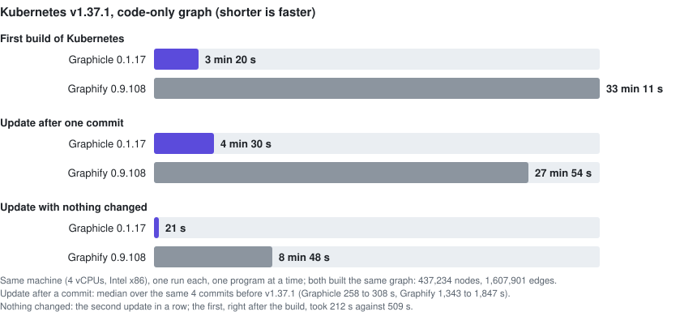

<p align="center">
  <picture>
    <source media="(prefers-color-scheme: dark)" srcset="assets/logo-dark.svg">
    
  </picture>
</p>

<h3 align="center">Graphify, ported to Rust. Plus memory.</h3>

<p align="center">
  Your coding agent asks Graphicle instead of grepping. It gets the functions, callers and past decisions it needs,
  cited to the exact file and line, from a code graph that stays current after every commit.
</p>

<p align="center">
  <a href="LICENSE"></a>
  <a href="https://github.com/graphicle-ai/graphicle/releases/latest"></a>
  
  <a href="https://discord.com/invite/rWuU7cWU4E"></a>
</p>

<p align="center">
  <sub>Works with Claude Code · Codex · Cursor · VS Code · Claude Desktop · any MCP client. Local: no API key, no account, no telemetry.</sub>
</p>

<p align="center">
  <picture>
    <source media="(prefers-color-scheme: dark)" srcset="assets/k8s-speed-dark.svg">
    
  </picture>
  <br><sub>Graphicle 0.1.17 against Graphify 0.9.108 on one machine (4 vCPUs, Intel x86), one run each, one program at a time. After ten updates, Graphicle's graph matched a fresh build of the same commit. <a href="docs/benchmarks.md#graphicle-0117-against-graphify-09108-on-kubernetes">Method and every measurement</a>. The code-graph engine is a Rust port of Graphify, <a href="#license-and-credits">credited below</a>; Graphicle is not affiliated with Graphify Labs.</sub>
</p>

## Quick start

```sh
brew install graphicle-ai/tap/graphicle
cd your-repo
graphicle setup
```

<sub>No Homebrew? <code>curl -fsSL https://github.com/graphicle-ai/graphicle/releases/latest/download/install.sh | sh</code> · Windows: a preview build ([install](docs/install.md))</sub>

`graphicle setup` builds the code graph, connects the coding agents it finds and keeps the graph current with Git hooks. It lists every file it changes and backs each one up first; `graphicle disconnect` undoes it all.

Then ask your agent to *"use graphicle to find where failed requests are retried"*, or ask from the terminal:

```console
$ graphicle ask "where is tax added to prices?"
Evidence for "where is tax added to prices?"
4 excerpts · 606 of 3,000 tokens

[1] shop/pricing.py:1-7  price_with_tax()
    """Prices and tax."""
    TAX_RATE = 0.2


    def price_with_tax(price):
        """A price with the sales tax added."""
        return round(price * (1 + TAX_RATE), 2)
```

<sub>Real output, cut after the first excerpt. No model needed: <code>ask</code> shows the evidence, and <code>graphicle config set model anthropic</code> (or <code>openai</code>, <code>ollama</code>) adds written answers.</sub>

## Why Graphicle

- **Fast on real repositories.** On Kubernetes, Graphicle 0.1.17 built the code graph in 3 min 20 s against 33 min 11 s for Graphify 0.9.108, updated it after a commit in 4 min 30 s against 27 min 54 s, and in 21 s against 8 min 48 s when nothing had changed (labels under the chart above).
- **Memory tied to your code.** Docs, decisions and past Claude Code and Codex sessions sit next to the graph. A memory is tied to the functions it is about and goes stale when that code changes.
- **Answers you can check.** Every excerpt names its file and lines, within a token budget you set. Memories an agent proposes wait for your approval.
- **One program, not a stack.** Code graph, memory, one MCP server, an app and the command line in one install, with one SQLite file. No Python, Docker or database server.

## What your agent gets

- **The code graph.** Files, functions, classes, calls and imports, parsed with tree-sitter and no model, under Graphify's tool names (`query_graph`, `get_neighbors`, `shortest_path`, ...). `graphicle graph affected "retry()"` lists what a change touches.
- **Project memory.** Markdown, PDF, Office and HTML docs, reviewed decisions and captured agent sessions, searched together with the code.
- **Cited context on a budget.** `graphicle context` and the MCP tools return excerpts with their sources, without calling a model.
- **Always current.** Graphicle syncs the files you changed before each answer, and Git hooks update the graph after each commit, merge and checkout.
- **An app.** `graphicle open` shows the graph, the sources and the memory in your browser, and is where you approve memories.

More: [packs for long-context models](docs/pack.md) · [reviews of a branch](docs/review.md) · [a project wiki](docs/wiki.md) · [from a bug on the screen to a tested fix](docs/flow.md) · [several repositories in one connection](docs/mcp.md#several-projects-in-one-connection)

## Works with your agents

`graphicle setup` connects every client it finds over MCP. Each file is backed up once as `<file>.graphicle-bak`, and `graphicle disconnect` removes what it added.

| Client | Where setup connects it | Session capture |
|---|---|---|
| Claude Code | `.mcp.json` in the repository | hooks in `.claude/settings.local.json` |
| Codex | `~/.codex/config.toml` | hooks in `~/.codex/hooks.json` |
| Cursor | `~/.cursor/mcp.json` | |
| VS Code | `.vscode/mcp.json` in the repository | |
| Claude Desktop | `claude_desktop_config.json` | |
| Muse Code | `~/.config/muse/settings.json` ([Muse Code](docs/muse-code.md)) | preview: `graphicle connect muse --hooks` |
| Any other MCP client | a short JSON entry ([MCP](docs/mcp.md)) | |

## Agent memory, compared

In a pre-release comparison with seven memory systems (development sets; one open model, Qwen3.8-27B, as every system's reader, judge and model; a pre-release build of Graphicle), Graphicle matched Hindsight 0.10.2 and beat Mem0 OSS 2.2.1 (the open-source library, not Mem0's hosted platform) on LoCoMo-10, with far fewer model calls while ingesting.

| System | LoCoMo-10 accuracy [95% CI] | Model calls per conversation, ingesting |
|---|---|---|
| **Graphicle** (pre-release build) | **87.7** [85.1, 90.2] | **12** |
| Hindsight 0.10.2 | 87.3 [85.6, 89.1] | 160 |
| Mem0 OSS 2.2.1 | 81.9 [79.6, 84.4] | 332 |

[All eight systems, the other two development sets and every caveat](docs/benchmarks.md#agent-memory-comparison-with-seven-memory-systems).

## Coming from Graphify?

The code-graph engine is a Rust port of Graphify that follows its releases (currently Graphify 0.9.103) and keeps its MCP tool names. `graphicle setup` offers to switch a repository, backs up each file it changes and never deletes `graphify-out/`. [Moving from Graphify](docs/migrate-from-graphify.md).

## FAQ

<details>
<summary><b>What leaves my machine?</b></summary>

Nothing by default, apart from a daily check for a new release (`GRAPHICLE_NO_UPDATE_NOTIFIER=1` turns it off). Graphicle reaches the network only for a model or connector you configure, a full `graphicle graph extract` (documents and images go to the LLM whose API key it finds), and the GitHub CLI for the commands that use it. Your sources, memories and graph live in one SQLite store in your user data folder; the app and its endpoints listen on 127.0.0.1. Sync respects `.gitignore` and skips `.env` files, keys and credentials. [Details](docs/faq.md)
</details>

<details>
<summary><b>Do I need an API key or a model?</b></summary>

No, for most of it. The code graph (with `--code-only`), sync, `context`, the MCP server, session capture and the app work without one. A model writes the answers of `graphicle ask` and proposes memories; local models through Ollama or any OpenAI-compatible server work ([configuration](docs/configuration.md#models)).
</details>

<details>
<summary><b>Will it handle my large repository?</b></summary>

Kubernetes (25,899 code files) builds in minutes on 4 vCPUs (chart above). By default a project can hold up to 100,000 text files and 1 GiB of text; you can raise both ([limits](docs/configuration.md#limits)).
</details>

<details>
<summary><b>Is there a version for teams?</b></summary>

Graphicle is free and open source under Apache-2.0, for individuals and teams alike. A commercial edition for teams is in private preview. To talk to us, start a [discussion](https://github.com/graphicle-ai/graphicle/discussions) or chat on [Discord](https://discord.com/invite/rWuU7cWU4E).
</details>

More answers: [FAQ](docs/faq.md) · [Troubleshooting](docs/troubleshooting.md) · or run `graphicle doctor`.

## Documentation

[Quick start](docs/quickstart.md) · [Agents](docs/agents.md) · [MCP](docs/mcp.md) · [Install](docs/install.md) · [Configuration](docs/configuration.md) · [Team server](docs/team.md) · [Moving from Graphify](docs/migrate-from-graphify.md) · [Benchmarks](docs/benchmarks.md) · [FAQ](docs/faq.md) · [Changelog](CHANGELOG.md)

The code: [`crates/graphicle/`](crates/graphicle/README.md) (the program), [`crates/graphicle-graph/`](crates/graphicle-graph/README.md) (the code-graph engine), [`crates/graphicle-memory/`](crates/graphicle-memory/README.md) (the memory library), SDKs for [Python](sdk/python/README.md) and [TypeScript](sdk/typescript/README.md).

## Contributing

Contributions are welcome under the Apache License 2.0, with a Developer Certificate of Origin sign-off (`git commit -s`) and no CLA. See [CONTRIBUTING.md](CONTRIBUTING.md). To report a security problem, follow [SECURITY.md](SECURITY.md) rather than opening a public issue.

## License and credits

Graphicle is licensed under the [Apache License 2.0](LICENSE). Copyright 2026 KarLex AI, Inc.

[Code signing policy](docs/code-signing.md): release builds are not yet signed with a trusted certificate. The Windows programs are signed through SignPath with a test certificate, which Windows does not trust, or left unsigned when that signing fails; each release's notes say which. Signing with the SignPath Foundation's certificate is planned. The policy also lists every case in which Graphicle contacts the network.

The code-graph engine is a Rust port of [Graphify](https://github.com/Graphify-Labs/graphify) by Safi Shamsi and the Graphify
contributors, licensed under Apache-2.0, with portions that remain available under the MIT License. Thank you.
[NOTICE](NOTICE), [NOTICE.md](NOTICE.md) and the `licenses/` folders hold the attributions and the licences of every adapted project and third-party component.

<p align="center"><br><b>If Graphicle is useful to you, star the repository so other developers find it.</b><br>
  <sub><a href="#quick-start">Try it</a> · <a href="https://github.com/graphicle-ai/graphicle/issues">Report a bug</a> · <a href="CONTRIBUTING.md">Contribute</a> · <a href="https://discord.com/invite/rWuU7cWU4E">Discord</a></sub><br>
  <sub>Built by <a href="https://www.karlex.ai"></a> <a href="https://www.karlex.ai">KarLex AI, Inc.</a></sub>
</p>
