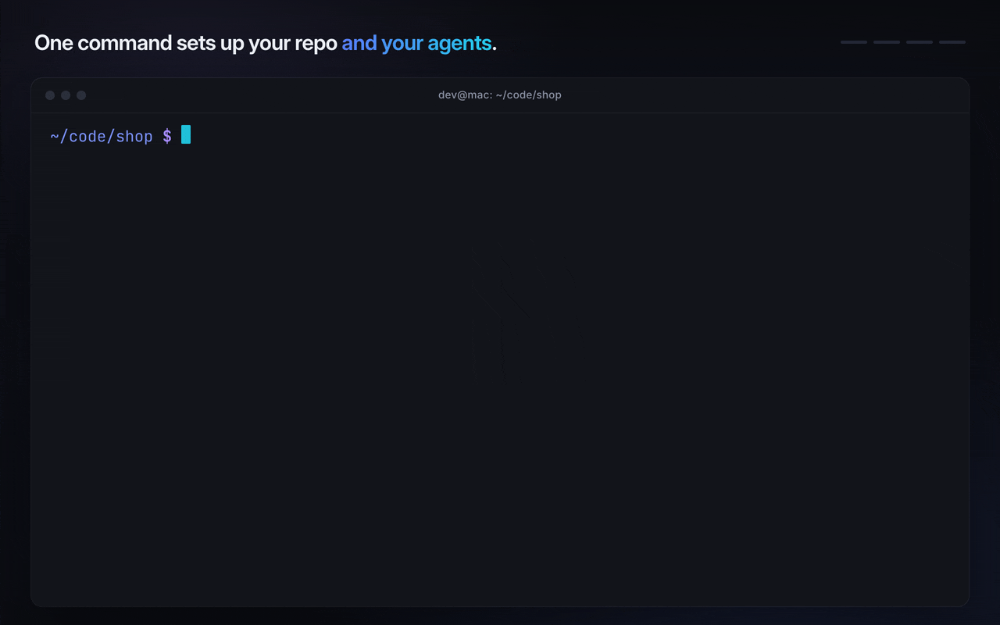
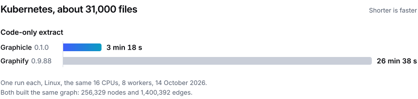
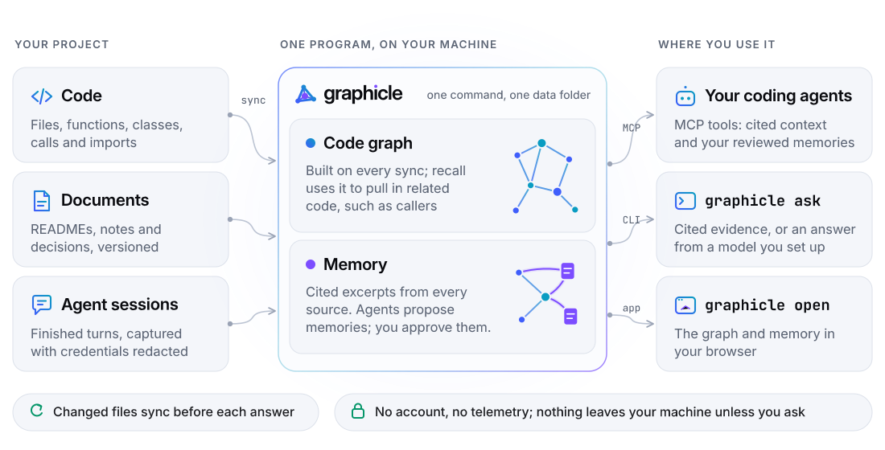

<p align="center">
  <picture>
    <source media="(prefers-color-scheme: dark)" srcset="assets/logo-dark.svg">
    
  </picture>
</p>

<h3 align="center">Code graph and memory for your coding agents, in one Rust program.</h3>

<p align="center">
  <a href="LICENSE"></a>
  <a href="https://github.com/graphicle-ai/graphicle/releases/latest"></a>
  
  <a href="https://discord.com/invite/rWuU7cWU4E"></a>
</p>

<p align="center">
  Graphicle maps your repository into a code graph, remembers your project's docs, decisions and past agent sessions,
  and gives your coding agent cited excerpts from both: the exact files and lines. It runs on your machine: no API key needed, no account, <a href="#privacy-and-local-first">no telemetry</a>.<br>
  <sub>Works with Claude Code · Cursor · Codex · VS Code · Claude Desktop · any MCP client</sub>
</p>

<p align="center">
  <a href="#quick-start">Quick start</a> · <a href="#how-it-works">How it works</a> · <a href="#benchmarks">Benchmarks</a> · <a href="docs/quickstart.md">Docs</a> · <a href="docs/migrate-from-graphify.md">Coming from Graphify?</a> · <a href="https://github.com/graphicle-ai/graphicle/discussions">Discussions</a>
</p>

<p align="center">
  
</p>

## Quick start

```sh
brew install graphicle-ai/tap/graphicle
cd your-repo
graphicle setup
```

<sub>No Homebrew? <code>curl -fsSL https://github.com/graphicle-ai/graphicle/releases/latest/download/install.sh | sh</code> · [Release archives](https://github.com/graphicle-ai/graphicle/releases) · [Other ways to install](docs/install.md)<br>
Windows: a preview build for x86-64, not yet code-signed ([Windows (preview)](docs/install.md#windows-preview)).</sub>

`graphicle setup` indexes the repository, builds its code graph and connects the coding agents it finds. It also turns on session
capture, adds a two-line section to `AGENTS.md` (unless Claude Code is the only agent) and installs Git hooks that keep the project current. It lists every file it changes and
backs each one up first; `graphicle disconnect` undoes it all.

Then ask your agent to *"use graphicle to find where failed requests are retried"*, or ask from the terminal:

```console
$ graphicle ask "where is tax added to prices?"
Evidence for "where is tax added to prices?"
4 excerpts · 598 of 3,000 tokens

[1] shop/pricing.py:1-7  price_with_tax()
    """Prices and tax."""
    TAX_RATE = 0.2


    def price_with_tax(price):
        """A price with the sales tax added."""
        return round(price * (1 + TAX_RATE), 2)
```

<sub>Real output, cut after the first excerpt. With no model configured, <code>ask</code> shows the evidence; <code>graphicle config set model anthropic</code> (or <code>openai</code>, <code>ollama</code>) adds written answers.</sub>

<details>
<summary><b>Let your coding agent install it</b></summary>

Paste this into Claude Code, Codex or Cursor:

```text
Install Graphicle with `brew install graphicle-ai/tap/graphicle` (or, without Homebrew,
`curl -fsSL https://github.com/graphicle-ai/graphicle/releases/latest/download/install.sh | sh`),
then run `graphicle setup --yes` in this repository and list every file it changed.
```
</details>

## Start here

| You want to | Run |
|---|---|
| Give your coding agent the code graph and your project's memory | `graphicle setup` in the repository |
| Ask a question from the terminal | `graphicle ask "how are failed requests retried?"` |
| Browse the graph, the sources and the memory | `graphicle open` |
| See what a change to a symbol touches | `graphicle graph extract . --code-only`, then `graphicle graph affected "retry()"` |
| Check that everything works | `graphicle doctor` |
| Undo everything setup did | `graphicle disconnect` |
| Move from Graphify, or run a server for a team | [Moving from Graphify](docs/migrate-from-graphify.md) · [Team server](docs/team.md) |

## Why Graphicle

- **Native and fast.** One Rust program. On Kubernetes (31k files), the 0.1.0 engine ran a code-only extract in 3 min 18 s, against 26 min 38 s for Graphify 0.9.88, and built the same graph (one exploratory run each, one Linux host, the same 16 CPUs, 8 workers).
- **Cited context, within a budget you set.** Your agent asks Graphicle and gets the relevant code, docs and decisions as cited excerpts, within a token budget you set. In our tests it tied grep on finding code, and we do not claim it saves tokens ([what we measured](#benchmarks)).
- **Answers you can check.** Every excerpt names its file and lines. Memories an agent proposes wait for your approval.
- **One program, not a stack.** The code graph, the memory, one MCP server, the web app and the command line come in one install, with one SQLite file. No Python, Docker or database server.
- **Local and private.** No account and no telemetry. Nothing leaves your machine unless you ask.

<p align="center">
  <picture>
    <source media="(prefers-color-scheme: dark)" srcset="assets/speed-kubernetes-dark.svg">
    
  </picture>
</p>

## What it does

- **Code graph.** Files, functions, classes, calls and imports, parsed with tree-sitter and no model. `graphicle graph` searches it, explains a symbol,
  traces a path and exports an interactive HTML graph. After `graphicle graph extract . --code-only`, `graphicle graph affected "retry()"` lists what depends on a symbol.
- **Project memory.** Docs (Markdown, PDF, Office, HTML), reviewed decisions and procedures, and past Claude Code and Codex sessions, searchable alongside the code.
- **Cited context on a budget.** `graphicle context` and the MCP tools return excerpts with their sources, within a token budget, without calling a model.
- **One MCP server.** `graphicle mcp` serves the code-graph tools, under Graphify's tool names such as `query_graph`, `get_neighbors` and `shortest_path`, next to the memory tools. With `--pull-requests` it also serves the pull-request tools `list_prs`, `get_pr_impact` and `triage_prs`, which use the GitHub CLI ([MCP](docs/mcp.md)).
- **Memory tied to your code.** Reviewed memories are tied to the functions they are about: a memory goes stale when that code changes, and edits elsewhere in the file usually leave it current ([the exact rule](crates/graphicle/README.md#memory-anchored-to-code-symbols)). Mentions of code in your docs are linked to the definitions they name (`graphicle call graph.doc_links` lists them).
- **Across repositories.** Recall can span the repositories of a workspace: `graphicle context --workspace`, or [the workspace MCP endpoint](docs/mcp.md#several-projects-in-one-connection).
- **Always current.** Before each answer Graphicle syncs the few files you changed; Git hooks sync after each commit, merge and checkout.
- **Sessions carry over.** Session capture keeps each finished turn, and once you have reviewed memories, each new session starts with them and the latest turns.
- **An app.** `graphicle open` shows the graph, the sources and the memory in your browser. It is where you approve memories.

## Works with your agents

`graphicle setup` connects every client it finds over MCP. Each file is backed up once as `<file>.graphicle-bak`, and `graphicle disconnect` removes what it added.

| Client | Where setup connects it | Session capture |
|---|---|---|
| Claude Code | `.mcp.json` in the repository | hooks in `.claude/settings.local.json` |
| Codex | `~/.codex/config.toml` | hooks in `~/.codex/hooks.json` (Codex asks you to trust them) |
| Cursor | `~/.cursor/mcp.json` | |
| VS Code | `.vscode/mcp.json` in the repository | |
| Claude Desktop | `claude_desktop_config.json` in Claude's settings folder | |
| Any other MCP client | a short JSON entry ([MCP](docs/mcp.md)) | |

## How it works

<p align="center">
  <picture>
    <source media="(prefers-color-scheme: dark)" srcset="assets/how-it-works-dark.svg">
    
  </picture>
</p>

1. **Sync.** Graphicle reads the folder (it respects `.gitignore` and skips secrets), keeps a versioned copy of each source and builds the code graph.
2. **Recall.** When your agent calls a tool, Graphicle syncs what changed, ranks excerpts from code, documents, sessions and reviewed memory, and returns them with citations. The tools call no model; your agent's own model reads the excerpts.
3. **Remember.** Captured sessions become sources. Memories that agents propose wait for your approval in the app.

## Graphicle, or a code-graph tool plus a memory server

The left column is a code-graph tool, such as Graphify's open-source engine, plus a separate memory server. It is not a comparison with Graphify Cloud, a hosted service that includes memory.

| | A code-graph tool + a memory server | Graphicle |
|---|---|---|
| Install | Two tools, often on different runtimes, and often a database server | One install |
| Connect your agents | Configure each tool in each agent | `graphicle setup` connects the agents it finds; `graphicle disconnect` undoes it |
| MCP servers in your agent | Two, configured separately | One, with the graph and the memory tools |
| Storage | Graph files plus the memory server's database | One SQLite file in one data folder |
| Code structure: calls, imports, impact | The graph tool | `graphicle graph` |
| Docs, decisions, past sessions | The memory server | Built in |
| Citations and review | Varies | A file and its lines on every excerpt; agent memories wait for approval |

## Benchmarks

Every figure is labelled, and [docs/benchmarks.md](docs/benchmarks.md) has the full tables, methods and limits. In the agent tests, a difference counts only when its 95% interval excludes 0; otherwise it is a tie. Long sessions and memory built up across coding sessions are not tested yet.

- **Speed.** The chart above: Kubernetes (31k files), the 0.1.0 engine (a Linux test build of the release source) against Graphify 0.9.88, one exploratory run each, both building the same graph ([Kubernetes run](docs/benchmarks.md#speed-on-kubernetes)). Earlier, on Django, a pre-release build ran a code-only extract in 7.5 s against 72.8 s for Graphify 0.9.77 (medians of five alternating runs, one shared Linux host, 8 workers), both building the same graph ([the 8 October record](docs/benchmarks.md#speed-against-graphify-0977)).
- **Updates.** After each of 30 commits on prometheus, tokio and poetry, Graphicle 0.1.0's `graph update` took 6 to 8 times less time than Graphify 0.9.91's (one Linux node, 4 CPUs per run), and both matched a fresh build apart from three kinds of keying difference that both programs share. In a 30-note sample, the 15 notes whose function changed were flagged and no other; a wider exploratory check found some false flags ([details and limits](docs/benchmarks.md#updates-after-commits)).
- **Peak memory.** A pre-release build with 0.1.1's changes to how the engine holds its data used less peak memory than Graphify 0.9.91 in all 39 cells measured (13 repositories; extract and two kinds of update), for example 2,092 against 2,767 MiB on the Kubernetes extract and 1,426 against 2,800 MiB on the next.js extract; a build of the merged 0.1.1 source stayed below in the 5 cells rechecked (one Linux 8×H100 node, GPUs not used; 8 workers; Graphicle's peak RSS against Graphify's peak PSS; [every cell](docs/benchmarks.md#peak-memory-against-graphify-0991)).
- **Finding code** (Claude Code 2.1.287 on a Linux node, Opus 5.5, effort medium). Graphicle ties grep. On 100 SWE-bench Verified tasks, plain Claude Code, Graphicle 0.1.0's default setup and Graphify 0.9.91 found every file the fix changed in 95, 95 and 94 of them; Graphicle used 16% and Graphify 29% more tokens than plain Claude Code, and the agent never called Graphicle's tools. On 93 tasks from our own code, which the model has not seen, all three tied again, and a prototype card from Graphicle 0.1.0's index (not shipped) used about 20% fewer tokens than Graphify.
- **Answering questions** (the same setup). On Graphify's showcase corpus (30 questions), the 0.1.1 agent defaults (a pre-release build) found 99.2% of the facts, against 94.7% for plain Claude Code (a tie) and 87.8% for Graphify 0.9.91: more facts than Graphify, with fewer tokens. On 60 questions about our own project all three tied, and Graphify used about 48k more tokens per question than Graphicle (pre-release 0.1.1 plus a prototype context hook) ([every agent test](docs/benchmarks.md#coding-agents-with-graphicle-graphify-or-neither)).
- **Agent memory.** In a comparison with seven memory systems, registered before any answer was scored and run with one open model as every system's reader and judge, a pre-release build of Graphicle trails none on three development sets. [Every score, with its method and caveats](docs/benchmarks.md#agent-memory-comparison-with-seven-memory-systems).

## FAQ

### Privacy and local first

- **One data folder.** Your sources, memories and the code graph that setup builds live in one SQLite store: `~/Library/Application Support/Graphicle` on macOS, `~/.local/share/graphicle` on Linux. `graphicle graph extract` writes its graph file to `.graphicle/` in the project.
- **Loopback by default.** The app and its HTTP and MCP endpoints listen on 127.0.0.1.
- **No telemetry, no account.** Graphicle connects to the network only when you ask it to: a model or a connector you configure, a full `graphicle graph extract`
  (it sends documents and images to the LLM whose API key it finds), the GitHub CLI for `graphicle graph add`, `clone` and the graph server's pull-request tools, and `graphicle update` with a feed you name.
  A build from source also downloads the parser sources once. [Details](docs/faq.md)
- **Careful sync.** `sync` respects `.gitignore` and skips `.env` files, keys and credentials. Session capture drops `<private>…</private>` spans and redacts credentials.
- **Forgetting with a receipt.** Deleting a memory or a captured session also removes what was derived from it, and you get a hash-chained deletion receipt.

<details>
<summary><b>Do I need an API key or a model?</b></summary>

No, for most of it. The code graph (with `--code-only`), sync, `context`, the MCP server, session capture and the app work without one.
A model writes the answers of `graphicle ask`, proposes memories from sources and reads documents and images in a full `graphicle graph extract`.
Local models through Ollama or any OpenAI-compatible server work ([configuration](docs/configuration.md#models)).
</details>

<details>
<summary><b>Is Graphicle a fork of Graphify?</b></summary>

The code-graph engine is a Rust port of Graphify, credited in its file headers and in [NOTICE](NOTICE). It follows Graphify 0.9.91, and later Graphify releases are ported in later versions; [the parity checks](docs/benchmarks.md#parity-with-graphify) compare it with that release.
The memory, the memory tools, the app and session capture are not part of Graphify. Coming from Graphify? `graphicle setup` offers to switch a repository,
backs up each file and never deletes `graphify-out/` ([Moving from Graphify](docs/migrate-from-graphify.md)).
</details>

<details>
<summary><b>Will it handle my large repository?</b></summary>

By default a project can hold up to 100,000 text files and 1 GiB of text; you can raise both (see [Limits in docs/configuration.md](docs/configuration.md#limits)).
A very large file is analysed in part or kept as searchable text instead of stopping a sync.
</details>

<details>
<summary><b>Is there a version for teams?</b></summary>

Graphicle is free and open source under Apache-2.0, for individuals and teams alike. A commercial edition for teams is in private preview.
To talk to us, start a discussion: https://github.com/graphicle-ai/graphicle/discussions, or chat with us on [Discord](https://discord.com/invite/rWuU7cWU4E).
</details>

<details>
<summary><b>What is the licence?</b></summary>

Graphicle is Apache-2.0: free to use, change and ship, commercially too. Third-party parts keep their own licences, listed in [NOTICE](NOTICE).
</details>

More answers: [FAQ](docs/faq.md) · [Troubleshooting](docs/troubleshooting.md) · or run `graphicle doctor`.

## Documentation

[Quick start](docs/quickstart.md) · [Agents](docs/agents.md) · [MCP](docs/mcp.md) · [Install](docs/install.md) · [Configuration](docs/configuration.md) ·
[Team server](docs/team.md) · [Moving from Graphify](docs/migrate-from-graphify.md) · [Benchmarks](docs/benchmarks.md) · [FAQ](docs/faq.md) · [Changelog](CHANGELOG.md)

The code: [`crates/graphicle/`](crates/graphicle/README.md) (the program: command line, app, HTTP and MCP server), [`crates/graphicle-graph/`](crates/graphicle-graph/README.md) (the code-graph engine),
[`crates/graphicle-memory/`](crates/graphicle-memory/README.md) (the memory library), SDKs for [Python](sdk/python/README.md) and [TypeScript](sdk/typescript/README.md),
and a team server recipe in [`deploy/`](deploy/README.md). Each crate builds on its own ([building from source](docs/install.md)).

## Contributing

Contributions are welcome under the Apache License 2.0, with a Developer Certificate of Origin sign-off (`git commit -s`) and no CLA.
See [CONTRIBUTING.md](CONTRIBUTING.md). To report a security problem, follow [SECURITY.md](SECURITY.md) rather than opening a public issue.

## License and credits

Graphicle is licensed under the [Apache License 2.0](LICENSE). Copyright 2026 KarLex AI, Inc.

The code-graph engine is a Rust port of [Graphify](https://github.com/Graphify-Labs/graphify) by Safi Shamsi and the Graphify
contributors, licensed under Apache-2.0, with portions that remain available under the MIT License. Thank you.
[NOTICE](NOTICE), [NOTICE.md](NOTICE.md) and the `licenses/` folders hold the attributions and the licences of every adapted project and third-party component.

<p align="center"><br><b>If Graphicle is useful to you, star the repository so other developers find it.</b><br>
  <sub><a href="#quick-start">Try it</a> · <a href="https://github.com/graphicle-ai/graphicle/issues">Report a bug</a> · <a href="CONTRIBUTING.md">Contribute</a> · <a href="https://discord.com/invite/rWuU7cWU4E">Discord</a></sub><br>
  <sub>Built by <a href="https://www.karlexai.com">KarLex AI</a></sub>
</p>
