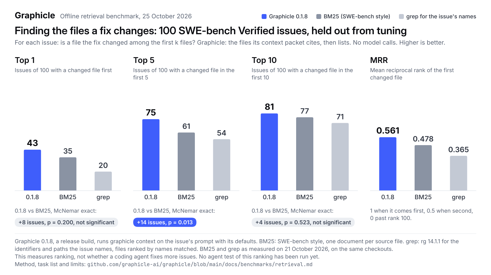

# Retrieval benchmark: finding the files a fix changes

Graphicle 0.1.8 was measured on 25 October 2026 and the other systems on
21 October 2026, offline: no model is called by any system here.

<p align="center">
  <picture>
    <source media="(prefers-color-scheme: dark)" srcset="../assets/retrieval-dark.svg">
    
  </picture>
</p>

## What this measures, and what it does not

For each issue, the benchmark asks whether a file that the issue's fix changed
is among the first k files a system returns (hit@k, for k = 1, 5 and 10), and
how high the first such file comes (mean reciprocal rank, MRR).

It measures ranking only. It does not measure whether a coding agent finds or
fixes more issues with Graphicle: that needs an agent test, and no agent test
of this ranking has been run yet. Our earlier agent tests, of 0.1.0 and 0.1.1
with Claude Code, found Graphicle tied with plain Claude Code on finding the
files a fix changes
([agent tests](../benchmarks.md#coding-agents-with-graphicle-graphify-or-neither)).
The two baselines below are fixed procedures, defined exactly; they are not
what an agent does when it searches with grep or a search engine.

It does not measure how long a question takes. For the time of
`graphicle context` per question on kubernetes, measured independently by
the reporter of issue #8 and in our own run of 0.1.8 against 0.1.7, see
[Independent measurements](../benchmarks.md#independent-measurements).

## Results

### Held-out set: 100 SWE-bench Verified issues, never used for tuning

Graphicle 0.1.8 is a release build of the 0.1.8 source, measured on
25 October 2026. The 0.1.3 and 0.1.2 rows, and BM25 and grep, are the
21 October 2026 run, on the same checkouts.

| System | hit@1 | hit@5 | hit@10 | MRR |
|---|---|---|---|---|
| Graphicle 0.1.8 | 43 | 75 | 81 | 0.561 |
| BM25, SWE-bench style | 35 | 61 | 77 | 0.478 |
| grep for the names in the issue (rg 14.1.1) | 20 | 54 | 71 | 0.365 |
| Graphicle 0.1.8, its ranking before the packet | 42 | 76 | 81 | 0.563 |
| Graphicle 0.1.3 | 43 | 75 | 82 | 0.562 |
| Graphicle 0.1.2 | 13 | 30 | 30 | 0.191 |
| Graphicle 0.1.3, its ranking before the packet | 42 | 76 | 82 | 0.564 |
| Graphicle 0.1.2, its ranking before the packet | 16 | 29 | 35 | 0.225 |

McNemar exact test, Graphicle 0.1.8 against BM25, SWE-bench style:

| k | only Graphicle 0.1.8 has a hit | only BM25, SWE-bench style has a hit | p (two-sided) |
|---|---|---|---|
| 1 | 19 | 11 | 0.200 |
| 5 | 21 | 7 | 0.013 |
| 10 | 13 | 9 | 0.523 |

At the 0.05 level, against BM25: the first file, p = 0.200, not significant; the first 5 files, p = 0.013, significant; the first 10 files, p = 0.523, not significant.

McNemar exact test, Graphicle 0.1.3 against BM25, SWE-bench style:

| k | only Graphicle 0.1.3 has a hit | only BM25, SWE-bench style has a hit | p (two-sided) |
|---|---|---|---|
| 1 | 19 | 11 | 0.200 |
| 5 | 21 | 7 | 0.013 |
| 10 | 13 | 8 | 0.383 |

0.1.8 has a file the fix changed among its first 10 files for one issue fewer
than 0.1.3 (81 against 82); the first file and the first 5 are the same
counts.

### Development set: 80 issues filed in July 2026, used for tuning

0.1.3's ranking changes were developed and measured on this set, so its
Graphicle 0.1.3 numbers are optimistic; the held-out set is the fair
comparison. These rows are the 21 October 2026 run; 0.1.8 was not run on
this set.

| System | hit@1 | hit@5 | hit@10 | MRR |
|---|---|---|---|---|
| Graphicle 0.1.3 | 38 | 63 | 69 | 0.611 |
| Graphicle 0.1.2 | 12 | 27 | 27 | 0.227 |
| BM25, SWE-bench style | 34 | 51 | 57 | 0.522 |
| grep for the names in the issue (rg 14.1.1) | 30 | 51 | 59 | 0.501 |
| Graphicle 0.1.3, its ranking before the packet | 37 | 63 | 69 | 0.602 |
| Graphicle 0.1.2, its ranking before the packet | 8 | 26 | 29 | 0.213 |

### Prompt formats (development set, used for tuning)

The 78 development issues outside root-project/root, each wrapped four ways,
and Graphicle 0.1.3's ranking before the packet: the instructions above
with `<issue>` tags; SWE-agent's `<pr_description>` tags; Agentless's
`--- BEGIN ISSUE ---` and `--- END ISSUE ---` lines; and a question in plain
words followed by the error in an `<error>` block.

| Format | hit@1 | hit@5 | hit@10 | MRR |
|---|---|---|---|---|
| Instructions with `<issue>` tags | 36 | 61 | 67 | 0.599 |
| SWE-agent, `<pr_description>` | 35 | 62 | 67 | 0.590 |
| Agentless, `--- BEGIN ISSUE ---` | 35 | 57 | 67 | 0.586 |
| A question and an `<error>` block | 34 | 60 | 67 | 0.580 |

## Sets

### Held-out: SWE-bench Verified (100 issues, Python)

The 100 issues of our 15 October agent test, from SWE-bench Verified (`princeton-nlp/SWE-bench_Verified` at revision c104f840), all in Python: django/django 46, sympy/sympy 15, sphinx-doc/sphinx 9, matplotlib/matplotlib 7, scikit-learn/scikit-learn 7, astropy/astropy 4, pydata/xarray 4, pytest-dev/pytest 4, psf/requests 2, pylint-dev/pylint 2.

Never used for tuning: 0.1.3's ranking changes were developed and chosen on the development set. This set's totals were checked for each candidate build, and no per-issue result of it was read before the final build was fixed. Later releases were measured on it, not tuned on it.

Gold files: 1 gold file for 87 issues; 2 gold files for 8 issues; 3 gold files for 3 issues; 4 gold files for 1 issue; 21 gold files for 1 issue.

<details><summary>The 100 issues, by repository</summary>

- django/django (46): `django__django-10914`, `django__django-11163`, `django__django-11239`, `django__django-11400`, `django__django-11477`, `django__django-11790`, `django__django-12155`, `django__django-12273`, `django__django-12406`, `django__django-12774`, `django__django-12965`, `django__django-13158`, `django__django-13195`, `django__django-13212`, `django__django-13315`, `django__django-13343`, `django__django-13406`, `django__django-13410`, `django__django-13551`, `django__django-13741`, `django__django-13810`, `django__django-13821`, `django__django-13837`, `django__django-13933`, `django__django-13964`, `django__django-14155`, `django__django-14349`, `django__django-14373`, `django__django-14493`, `django__django-14580`, `django__django-14765`, `django__django-14855`, `django__django-14999`, `django__django-15252`, `django__django-15277`, `django__django-15382`, `django__django-15629`, `django__django-15695`, `django__django-16082`, `django__django-16315`, `django__django-16333`, `django__django-16485`, `django__django-16493`, `django__django-16527`, `django__django-16819`, `django__django-9296`
- sympy/sympy (15): `sympy__sympy-11618`, `sympy__sympy-12096`, `sympy__sympy-12419`, `sympy__sympy-13091`, `sympy__sympy-14248`, `sympy__sympy-14976`, `sympy__sympy-15875`, `sympy__sympy-16450`, `sympy__sympy-17630`, `sympy__sympy-18211`, `sympy__sympy-19637`, `sympy__sympy-19783`, `sympy__sympy-22080`, `sympy__sympy-24213`, `sympy__sympy-24562`
- sphinx-doc/sphinx (9): `sphinx-doc__sphinx-10323`, `sphinx-doc__sphinx-11445`, `sphinx-doc__sphinx-11510`, `sphinx-doc__sphinx-7985`, `sphinx-doc__sphinx-8459`, `sphinx-doc__sphinx-8721`, `sphinx-doc__sphinx-9229`, `sphinx-doc__sphinx-9281`, `sphinx-doc__sphinx-9602`
- matplotlib/matplotlib (7): `matplotlib__matplotlib-20676`, `matplotlib__matplotlib-23412`, `matplotlib__matplotlib-23476`, `matplotlib__matplotlib-24570`, `matplotlib__matplotlib-25287`, `matplotlib__matplotlib-26113`, `matplotlib__matplotlib-26466`
- scikit-learn/scikit-learn (7): `scikit-learn__scikit-learn-10297`, `scikit-learn__scikit-learn-10908`, `scikit-learn__scikit-learn-13124`, `scikit-learn__scikit-learn-13328`, `scikit-learn__scikit-learn-25747`, `scikit-learn__scikit-learn-25931`, `scikit-learn__scikit-learn-9288`
- astropy/astropy (4): `astropy__astropy-13453`, `astropy__astropy-13579`, `astropy__astropy-7336`, `astropy__astropy-8872`
- pydata/xarray (4): `pydata__xarray-3095`, `pydata__xarray-3677`, `pydata__xarray-4356`, `pydata__xarray-4695`
- pytest-dev/pytest (4): `pytest-dev__pytest-10051`, `pytest-dev__pytest-10081`, `pytest-dev__pytest-5809`, `pytest-dev__pytest-6202`
- psf/requests (2): `psf__requests-1142`, `psf__requests-5414`
- pylint-dev/pylint (2): `pylint-dev__pylint-4661`, `pylint-dev__pylint-6528`

</details>

### Development: 80 issues filed in July 2026 (Rust, Java, C, C#, C++, JavaScript and TypeScript)

80 issues and fixes filed after the training cutoff of the model in our agent tests (July 2026), on 38 less-starred public repositories created before June 2026, so it is not code that model has never seen. The fixing pull requests were created from 2 to 30 July 2026, from SWE-bench-Live/MultiLang and SWE-bench-Live/Windows. Languages: Rust 26, Java 20, C 9, C# 9, C++ 8, JavaScript or TypeScript 8.

This set was used for tuning: 0.1.3's ranking changes were developed and measured on it.

Gold files: 1 gold file for 50 issues; 2 gold files for 14 issues; 3 gold files for 6 issues; 4 gold files for 8 issues; 5 gold files for 2 issues.

<details><summary>The 80 issues, by language</summary>

- Rust (26): `agentgateway__agentgateway-2452`, `gitbutlerapp__gitbutler-14920`, `gleam-lang__gleam-5958`, `gleam-lang__gleam-6021`, `h4ckf0r0day__obscura-412`, `h4ckf0r0day__obscura-421`, `h4ckf0r0day__obscura-440`, `lakehq__sail-2292`, `lance-format__lance-7618`, `lance-format__lance-8049`, `modelcontextprotocol__rust-sdk-1005`, `modelcontextprotocol__rust-sdk-1021`, `modelcontextprotocol__rust-sdk-996`, `nearai__ironclaw-6706`, `nearai__ironclaw-6712`, `prefix-dev__pixi-6518`, `prefix-dev__pixi-6529`, `rust-lang__rust-analyzer-22751`, `rust-lang__rust-analyzer-22804`, `rust-lang__rust-analyzer-22855`, `web-infra-dev__rspack-14794`, `web-infra-dev__rspack-14803`, `web-infra-dev__rspack-14882`, `yvgude__lean-ctx-1179`, `yvgude__lean-ctx-816`, `yvgude__lean-ctx-969`
- Java (20): `agentscope-ai__agentscope-java-2189`, `agentscope-ai__agentscope-java-2257`, `agentscope-ai__agentscope-java-2260`, `apache__paimon-8536`, `apache__paimon-8874`, `apache__parquet-java-3642`, `apache__parquet-java-3645`, `apache__parquet-java-3669`, `apache__shardingsphere-39104`, `apache__shardingsphere-39137`, `apache__shardingsphere-39237`, `btraceio__btrace-894`, `btraceio__btrace-895`, `btraceio__btrace-910`, `floci-io__floci-1837`, `floci-io__floci-1870`, `floci-io__floci-2015`, `langchain4j__langchain4j-5755`, `langchain4j__langchain4j-5847`, `langchain4j__langchain4j-5869`
- C (9): `DynamoRIO__dynamorio-8017`, `c-ares__c-ares-1190`, `colbymchenry__codegraph-1317`, `colbymchenry__codegraph-1318`, `colbymchenry__codegraph-1370`, `fluent__fluent-bit-12029`, `xroche__httrack-599`, `xroche__httrack-618`, `xroche__httrack-811`
- C# (9): `JasperFx__marten-5080`, `JasperFx__wolverine-3456`, `JasperFx__wolverine-3582`, `JasperFx__wolverine-3695`, `SubtitleEdit__subtitleedit-12151`, `SubtitleEdit__subtitleedit-12763`, `SubtitleEdit__subtitleedit-12895`, `elsa-workflows__elsa-core-7898`, `nunit__nunit-5351`
- C++ (8): `IfcOpenShell__IfcOpenShell-8887`, `duckdb__ducklake-1339`, `duckdb__ducklake-1340`, `kvcache-ai__Mooncake-2892`, `kvcache-ai__Mooncake-2964`, `luau-lang__luau-2506`, `root-project__root-22854`, `root-project__root-22857`
- JavaScript or TypeScript (8): `jsonata-js__jsonata-814`, `notionnext-org__NotionNext-4290`, `open-gsd__gsd-core-2079`, `open-gsd__gsd-core-2233`, `open-gsd__gsd-core-2261`, `playcanvas__engine-9000`, `playcanvas__engine-9002`, `playcanvas__engine-9066`

</details>

## Systems

Each issue's repository is checked out at the issue's base commit, and every
system works on that checkout alone.

- **Graphicle 0.1.8.** A release build of the 0.1.8 source, run as 0.1.3
  below, with the same arguments, which are also 0.1.8's `graphicle context`
  defaults.
- **Graphicle 0.1.3.** A release build of the 0.1.3 source. `graphicle setup`
  syncs the checkout into a fresh data folder with its defaults. Then `graphicle call context` answers the question
  with the arguments `graphicle context` uses by default: at most 8,400
  characters and 3,000 tokens, the identifier route on. The question is the
  prompt an agent got in our agent tests: the instructions below with the
  issue between `<issue>` tags. The files counted are those the packet's
  excerpts cite, in order, then the files the packet lists after them, each
  file once.
- **Graphicle 0.1.2.** The release binary (GitHub release v0.1.2, Linux
  x86-64, checked against its `SHA256SUMS`), the same setup and question, and
  0.1.2's `graphicle context` defaults: 3,000 tokens, which 0.1.2 packs into
  at most 12,000 characters. Its packet lists no files after its excerpts.
- **Graphicle, its ranking before the packet** (both versions, in the tables
  only): the fused order of up to 400 passages that the packet is chosen from
  (`debug_candidates: 400`), each file at its first passage.
- **BM25, SWE-bench style.** One document per source file (its path and
  contents); Lucene's BM25 with Pyserini's defaults (k1 0.9, b 0.4); the query
  is the issue text, as lowercase word tokens without Lucene's English stop
  words and without stemming. Documents: the files Git tracks that have a code
  extension (tests included), outside vendored and generated folders; every
  gold file is a document.
- **grep for the names in the issue.** The identifiers and paths the issue
  text names (code spans, `snake_case`, camelCase, calls and qualified names;
  at most 40), each searched with `rg -F -w --count-matches` (ripgrep 14.1.1)
  over the same files. Files are ranked by the number of distinct names they
  match, then by the total number of matches. A named path matches the files
  it ends with and the files that end with it.

The prompt, with the issue in place of `ISSUE`:

````text
The current folder is a checkout of a software repository. A user reported the issue below.

<issue>
ISSUE
</issue>

Your task is to find where the code must change to resolve this issue. Do not fix it: do not edit, create or delete any file. Investigate the repository as you see fit.

When you are done, end your answer with exactly one JSON code block in this form:

```json
{"files": [{"path": "path/from/the/repository/root.py", "functions": ["ClassName.method_name", "function_name"]}]}
```

List at most 5 files, the most likely first. List only files that exist in the repository now and would need to change in a fix; leave out tests and documentation. For each file, list the functions or methods that would change, as ClassName.method_name for methods; use an empty list if you cannot tell.
````

## Metrics

- **Gold files.** The files the fix modifies or deletes that exist at the base
  commit and have a code extension, without tests and documentation. Files
  the fix creates are not gold. A Rust file changed only in its test code is
  not gold.
- **hit@k.** The number of issues with a gold file among the first k files.
- **MRR.** The mean over the issues of 1 / the rank of the first gold file,
  0 when it is not in the first 100.
- **McNemar exact test.** Graphicle 0.1.8, and 0.1.3, against BM25 at each
  k, on the same issues: a two-sided binomial test on the issues where exactly
  one of the two has a hit.

## Limitations

- **Ranking, not agent success.** A file in the first 10 is not a fix, and an
  agent may find the file another way; no agent test of this ranking has been
  run yet.
- **Prompt formats.** Both sets wrap every issue in the same instructions and
  `<issue>` tags, and 0.1.3 and later read marked content first. The check
  below re-wraps the development issues in three other formats; the held-out
  set was not re-wrapped.
- **Python only, held out.** The held-out issues are all Python, and 46 of
  them are Django's. The development set covers the other languages, but it
  was used for tuning.
- **Gold labels.** Only files the fix changed count. A file an agent could
  start from that the fix did not change is a miss here.
- **Different units.** BM25 and grep rank whole files. Graphicle ranks
  passages and reports files, within a character budget.
- **Budgets.** Graphicle 0.1.2 ran with its own default budget, 12,000
  characters against 8,400 for 0.1.3 and 0.1.8, which gives its packet more
  room.
- **Long questions.** Graphicle 0.1.2 refuses a question over 16,000 bytes.
  Two development issues are that long, and they count as misses for it;
  0.1.3 and 0.1.8 shorten such a question instead. No held-out question is
  that long.
- **Size.** 100 held-out issues: the McNemar tests above give the chance of
  differences this large between two equal systems.
- **One run.** One run per system on one Linux machine; the systems are
  deterministic for a given checkout and settings.

## Files

- [`retrieval.json`](retrieval.json): every issue of both sets, with its
  repository, language and number of gold files; each system's results; for
  each pair compared, the issues where only one of the two has a hit at each
  k; and the chart's texts.
- [`retrieval_chart.py`](retrieval_chart.py): prints the results tables and
  McNemar tests on this page from `retrieval.json` (`--tables`) and draws the
  chart (`docs/assets/retrieval-light` and `-dark`, SVG and PNG). The prompt
  format table comes from the same harness and is not in the data file.
- The harness that prepared the issues, ran the systems and computed the
  baselines is not published.
